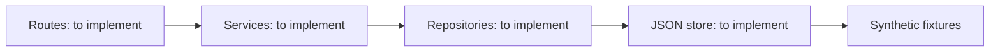

# Order API practice exercise

An unfinished Express/TypeScript exercise about turning customer, product and order fixtures into a layered HTTP API. Its focus is repository queries, order hydration, integer-cent totals, pagination and customer aggregation.

**Current status:** the app, store and service functions contain deliberate `Not implemented yet` stubs. It does not start a usable server. Type checking passes; acceptance tests do not. Present this as learning material rather than a completed order-management system.

## Measure the baseline

Use Node 22:

```sh
npm ci --ignore-scripts
npm run typecheck
npm test
```

Verification found 29 collected service tests failing. The API test file fails during import because initialization throws, so its 25 declared cases are not collected. There are 54 declared cases in total; they did not all execute.

`npm run dev` is an intended future entry point and currently reaches the unfinished code. The removed source-copying `test:solutions` helper referenced an absent `solutions/` directory. No reference implementation is supplied.

## Intended implementation



Fixtures contain six customers, eight products and ten orders. Preserve the function signatures, supplied tests and fixture contract while implementing TODOs:

1. Load/reset the store and implement repositories.
2. Hydrate orders with customer/product details and calculate cent totals.
3. Validate order creation, filter/paginate orders and aggregate customer summaries.
4. Wire routes, authentication, logging and error handling.

| Target route | Intended behavior |
| --- | --- |
| `GET /orders` | Filter and paginate |
| `GET /orders/:id` | Hydrate customer/product lines |
| `POST /orders` | Validate and create an in-memory order |
| `GET /customers` | Optional tier filter |
| `GET /customers/:id/summary` | Orders and aggregate totals |

[API_EXERCISE.md](API_EXERCISE.md) preserves target request/response examples. These specify behavior to build, not responses observed from a working server. The planned `x-api-key` and `test-key` fixture are exercise mechanisms, not production authentication.

## Portfolio boundary

The planned store is in memory; writes would not be durable. There is no implemented database, payment workflow, production identity design or concurrency control. Keep this unpinned until implemented and tested; use completed APIs for the main portfolio. This pass preserves all source stubs, tests and data. No functioning server or screenshot was fabricated.
